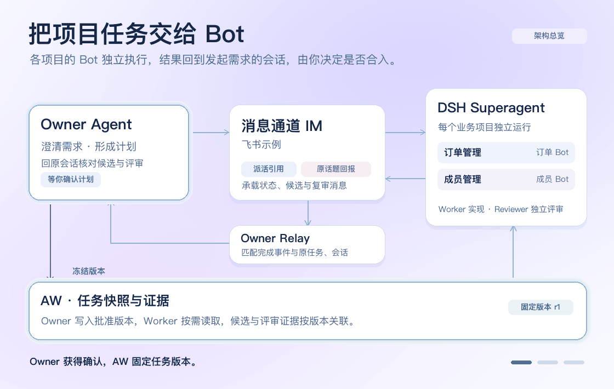
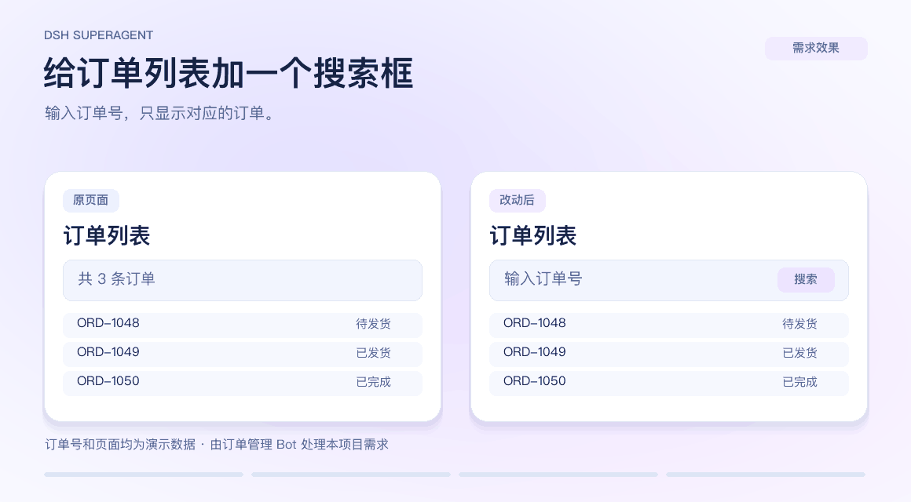

# DSH Project Bots

**一个项目，一个 Bot。把注意力留给决策，同时多试几个方向。**

这是对 **DeepSeek Harness Superagent 的实践探索**。我给每个业务项目配一个 Bot，像自己的项目分身，替我执行已确认的任务。结果回到发起需求的会话，我看过候选和评审，再决定是否合入。

An exploration of DeepSeek Harness Superagent with one Bot per project and delivery back to the original Owner conversation.

[静态架构图](docs/assets/project-bots-flow.png) · [安装指南](docs/install.md) · [部署边界与交接时序](docs/architecture.md)

## 一条需求怎么走

给订单列表增加按订单号搜索。动图从页面效果开始，跟着同一条需求经过快照、派活、实现、独立评审和 Owner 复审。订单和页面均为演示数据。

[静态分镜](docs/assets/order-search-storyboard.png) · [站点状态页真实交付记录](docs/example.md#站点状态页真实交付)

一个 Bot 对应一个业务项目。项目里的前端、后端可以各用自己的仓库和工具链，任务按批准版本选仓。

## 在 Superagent 上扩展了什么

- **项目与任务绑定。** AW 固定批准范围、仓库、基线和验收条件，执行和评审引用同一版本。
- **项目 Bot 执行。** DSH Superagent 沿用原生接单、Ticket、Worker 和回报能力，产出可审查的代码候选。
- **交付接回原会话。** IM 传递任务引用与回报，这里以飞书为例。Owner Relay 匹配原任务和会话，Owner Agent 核对实际差异与证据。当前提供 Codex 自动接续示例，其他 Owner Agent 可接入相应的会话队列或 API。

这套用法延续上游少占人的注意力、在有结果或需要决策时回到人的原则。[DeepSeek 团队的设计说明](https://github.com/deepseek-ai/dsh-superagent-prototype/blob/main/docs/000-philosophy.md)

## 当前版本

仓库提供可安装候选源码、Compose、Owner Skill 与演示项目。Mac Apple Silicon 和 Linux x86_64 已通过基础安装，验证了服务启动、DSH 读取 AW 和重启后的数据保留。本次发布候选的真实首单闭环待验收。[安装指南](docs/install.md)

本项目是对 DeepSeek Harness Superagent 的独立扩展。各组件和第三方依赖的许可见相应源码和发布说明。
