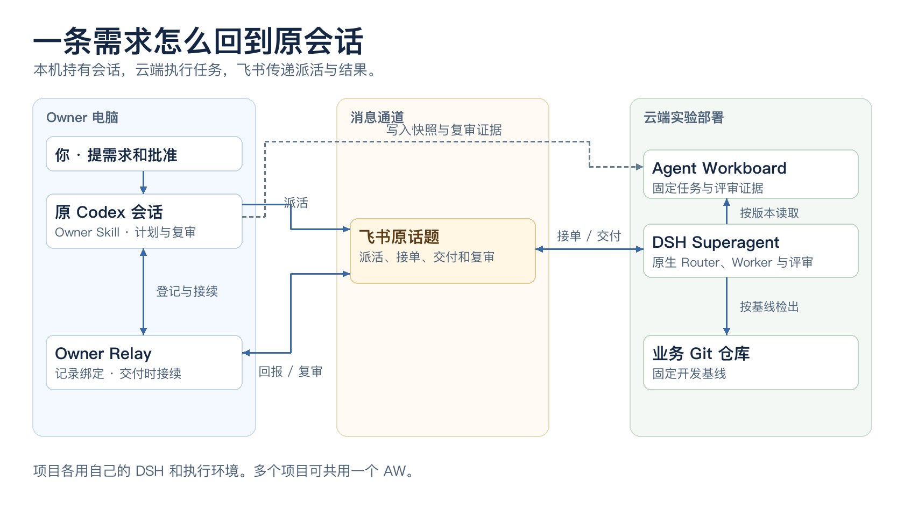

# Superagent Delivery

**把你批准的一条需求，交给 AI 实现，再把候选代码、测试结果和复审结论带回原会话。**

An approval-to-review workflow for DeepSeek Harness Superagent, with versioned task snapshots and traceable delivery evidence.

你在 Codex 里说明要改什么。确认计划后，任务通过飞书交给 Superagent。实现、验证和独立评审结束后，结果回到发起需求的对话。你可以看实际差异、在看板查进展，再决定是否合入。

[看一条需求怎么走](docs/example.md) · [了解架构和部署方式](docs/architecture.md)

## 能解决什么

| 常见问题 | 这套流程提供的东西 |
| --- | --- |
| Agent 开工后改了需求，后来看不出当时到底批准了什么 | **固定任务快照。** 保存批准的范围、仓库、基线和验收条件。执行和评审引用同一版。 |
| 派活后想知道进度，得翻群消息或一直盯着对话 | **结果主动接续。** 飞书传递派活和回报，Owner Relay 把交付接回原会话。AW 按实际事件显示派活、候选、评审和有证据的返工。 |
| Agent 说「做完了」，却不知道测过什么、改的是哪版代码 | **可复核的候选。** 测试、独立评审和 Owner 复审都关联实际提交。Owner 对照批准条件核对差异，合入由你确认。 |

## 四个部件各管什么

- **Owner Skill（`$dsh-sa`）** 用在 Codex。负责接入项目、整理需求、经批准派活和最终复审。
- **DSH Superagent** 沿用原生的接单、任务、Worker、评审与回报能力，在隔离工作区交付候选。
- **AW（Agent Workboard）** 保存固定任务与证据，也提供只读看板。
- **Owner Relay** 跑在原 Codex 会话所在机器。把飞书里的接单和交付与原话题、原会话关联，按事件接续。

## 先试着读一单

打开 [站点状态页示例](docs/example.md)。你能对照看到任务里写了什么、实施交回什么、Owner 凭什么说通过。这份示例可直接阅读。

已有实验项目完成了真实代码需求的固定快照、隔离实施、独立评审和原会话复审。升级版的**自动绑定接单**已完成本地模拟测试和实验环境上线检查，真实新单的验收单独记录。对外可复现安装所需的版本和准备项见[部署说明](docs/architecture.md#部署方式)。

本项目是对 DeepSeek Harness Superagent 的独立集成。各组件与第三方依赖的授权以其发布仓库和许可证为准。
