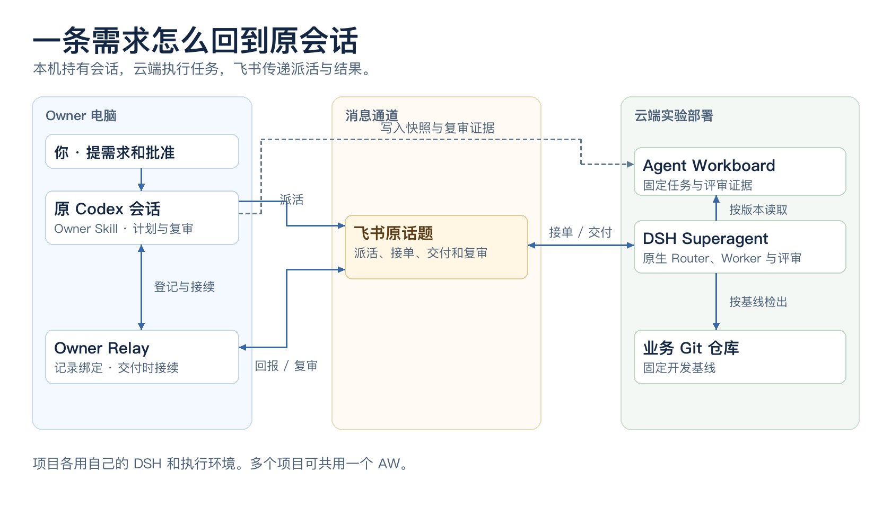
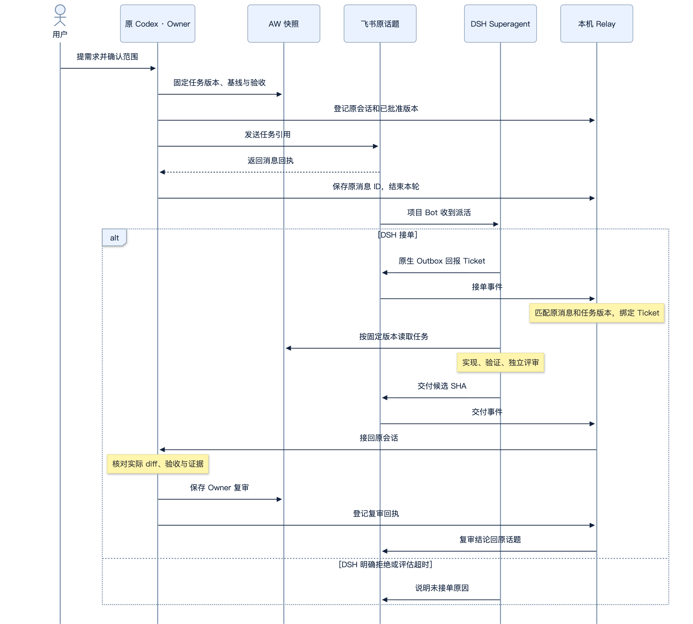

# 系统如何协作

## 部署边界

AW 保存批准版本和证据。云端 DSH 通过任务引用读取快照，通过项目自己的配置选择仓库与工具链。Worker 在隔离工作区完成代码和测试，独立 Reviewer 检查最终候选。

飞书承载派活与报告。Relay 在原 Codex 会话所在机器接收同一话题的结构化回报。接单关联原消息与 Ticket；首次匹配的执行回报补齐本轮 Assignment，交付回报接续 Owner。Owner 查看实际候选与证据，再更新 AW 并回报原话题。Codex 会话和工作目录的绑定信息保存在 Owner 所在机器。

## 交接时序

发生明确拒绝或评估超时时，原话题会说明原因。一直缺接单证据时，提示「接单未确认」，后续由原 Owner 核对原消息再决定如何处理。返工沿同一 Ticket 追踪，各轮候选和评审分别保留。

## 部署方式

| 路线 | 放在哪里 | 当前证据 |
| --- | --- | --- |
| 云端 | 各项目的 DSH 实例与共享 AW 放在服务器。Owner Skill 与 Relay 放在持有 Codex 会话的机器。 | 已用真实需求走过固定快照、实施、独立评审和自动回原会话。新版接单自动绑定在本地模拟与上线检查中验证。 |
| 本地 | DSH、AW 和 Relay 可以在同一台机器，以独立目录和配置启动。 | 已验证隔离启动和模拟接收。从零连接真实模型与飞书、完成整单的复现仍需记录。 |

复现需要可用模型接入、业务 Git 仓库与对应权限、AW、飞书测试群和 Bot 配置，以及能够接续原 Codex 会话的本机 Relay。[安装指南](install.md) 提供当前候选的 Compose、版本与配置样例。Mac Apple Silicon 和 Linux x86_64 均已完成基础安装验证，当前候选的真实首单闭环待验收。

可编辑源图：[部署边界](../assets/architecture.mmd) · [交接时序](../assets/delivery-sequence.mmd)
